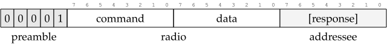
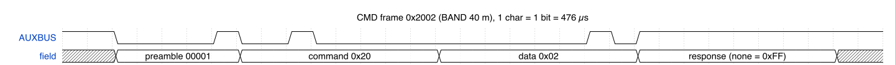
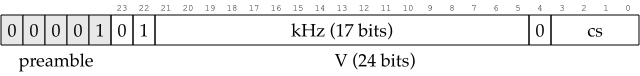
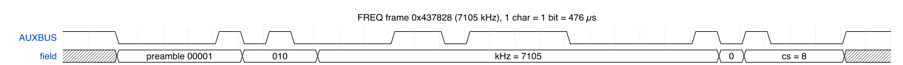
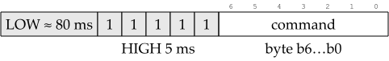
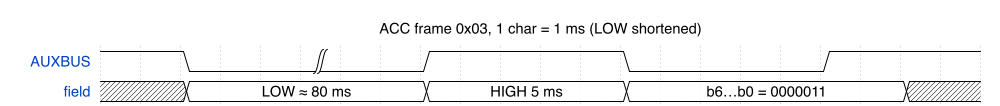
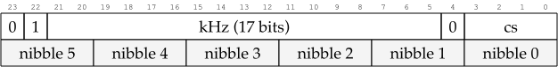

# Elecraft AUXBUS

English | [Polski](AUXBUS.pl.md)

> AUXBUS is a proprietary protocol of Elecraft. This description is based
> on the analysis of sniffed communication between the K4, K3, KPA1500,
> KPA500 and KRC2, and on publicly available Elecraft documentation. It is
> not official documentation and may contain errors.

## 1. Physical layer

| Parameter | Value |
|---|---|
| Line | a single wire shared by all devices |
| Outputs | open collector / open drain, line pulled up to +5 V |
| Idle | HIGH |
| Logic | HIGH = `1`, LOW = `0` |
| Bit order | MSB first |
| Direction | half-duplex, one device transmits at a time |
| Coding | NRZ, no start or stop bits; synchronisation on the preamble only |

A device transmits `0` by pulling the line to ground and `1` by releasing
the line. The line is never actively driven HIGH.

The bus carries frames at two different speeds.

| Frame | Sender | Bit time | Initial LOW | Data bits |
|---|---|---|---|---|
| **K\*** | radio (K4, K3) | **476.1 µs** (≈ 2100 bit/s) | ≈ 1.9 ms | 16 or 24 |
| **ACC** | accessory (KPA1500, KPA500) | **1000 µs** | ≈ 80 ms | 7 |

The name “K\*” covers the Elecraft transceivers that send this format
(K4 and K3?). “ACC” denotes an accessory frame (e.g. from the KPA1500
amplifier).

Bits with the value `1` at the end of a frame produce no edge and merge
with the idle state. A receiver therefore cannot find the end of a frame
from the edges. It always samples a fixed number of bits, counting time
from the preamble.

---

## 2. K* frame

### 2.1 Preamble

The preamble is 5 bits `00001`:

- LOW for **1896 µs** (4 bits),
- HIGH for 476 µs (1 bit).

The rising edge that ends the LOW (called `t_r` below) is the only
synchronisation point of the frame. The first data bit starts 476 µs
after `t_r`, and the middle of data bit `k` (k = 0, 1, 2…) is at:

```
t(k) = t_r + 714.15 µs + k · 476.1 µs
```

### 2.2 Two variants: CMD and FREQ

The first byte after the preamble selects the variant:

| First byte | Variant | Bits after the preamble |
|---|---|---|
| `0x40`–`0x7F` (`0b01xxxxxx`) | **FREQ**: frequency | 24 |
| any other (in practice `0x20`–`0x3F`) | **CMD**: command | 16, optionally followed by an 8-bit response |

The K4 always sends FREQ with a first byte of `0x40`–`0x5F`.

### 2.3 CMD frame



- **command**: command code (list in [chapter 4](#4-k-commands)),
- **data**: command argument,
- **response**: a byte the addressee may send back right after the frame.
  It is sent by the addressee, not by the radio (see [2.5](#25-response)).

Example: `0x2002`, i.e. BAND = 40 m, no response (response = `0xFF`).



Duration: 21 bits ≈ 10.0 ms, plus a 3.8 ms response window.

### 2.4 FREQ frame



Full description and checksum: [chapter 5](#5-freq-frame).

Example: 7105 kHz, `V = 0x437828`.



Duration: 29 bits ≈ 13.8 ms.

### 2.5 Response

After a CMD frame the radio releases the line and listens for a response.
The response is a single byte: no preamble, 8 bits of 476 µs, MSB first.

The K4 samples the response at:

```
t_end + 238.1 µs + j · 476.1 µs,   j = 0…7
```

`t_end` is the end of the last `data` bit (`t_r` + 17 · 476.1 µs). This is
the same sampling grid as the frame bits, i.e. samples 16–23 counted from
the preamble. No response gives `0xFF`. The radio does not listen for a
response after a FREQ frame.

Of the known devices only the KRC2 responds, and only to commands `0x34`
and `0x35`. The KRC2 starts its response 274–290 µs after `t_end`, and
its bit lasts ≈ 479 µs. The first K4 sample (238 µs) therefore falls
before the response starts, and the following ones near the end of each
bit. As a result the K4 would read `0x80 | (response >> 1)`; for example
`0x43` gives `0xA1`.

The KRC2 response ends ≈ 4.1 ms after `t_end`, i.e. after the K4
listening window (≈ 3.8 ms). This causes an inconsistency that still
needs to be explained. If the last response bit is `0`, the line is LOW
when the K4 returns to waiting for ACC frames. The K4 may receive this as
an ACC frame with the value `0x7F`, which it ignores (see
[chapter 6](#6-acc-commands)).

### 2.6 Receiving a K* frame

1. A frame starts with a falling edge after at least 4 ms of idle.
2. The LOW must last 1.6–2.2 ms.
3. From the rising edge `t_r`, wait 1.5 bit times and read the first byte.
4. A first byte of `0x40`–`0x7F` means FREQ: read 16 more bits and check
   the checksum.
5. Any other byte means CMD: read 8 more bits of `data`, and another 8
   for the response (`t(16)`…`t(23)`).

A receiver that always collects 24 bits gets, for a CMD frame without a
response, the value `(command << 16) | (data << 8) | 0xFF`.

---

## 3. ACC frame

An ACC frame is sent by an accessory to the radio. It has no type field
and no checksum.



The rising edge that ends the LOW is `t_r`; the data occupies the time
from `t_r` + 5 ms to `t_r` + 12 ms.

- The LOW of ≈ 80 ms (KPA1500: 79.91 ms) seizes the bus and signals an
  ACC frame.
- 5 ms of HIGH (5 bits `1`) is the synchronisation part.
- 7 data bits of 1000 µs, MSB first. The transmitted byte is always
  `0x00`–`0x7F`.



### 3.1 How the K4 receives an ACC frame

- Any LOW on an idle bus that is not its own transmission or response
  window is treated by the K4 as the start of an ACC frame.
- After the LOW it waits for HIGH (`t_r`). It samples bit `k` (k = 0…6,
  i.e. b6…b0) at `t_r` + 5500 µs + k · 1000 µs.
- After receiving the byte the K4 ignores the bus for ≈ 16 ms. The next
  frame is received if its LOW is still present at ≈ `t_r` + 28 ms.
- From the first LOW until the end of this pause the K4 does not
  transmit its own frames; it postpones them.
- The K4 has no timeout on LOW. A line held LOW permanently blocks K4
  transmissions.

---

## 4. K* commands

| command | Name | data | Who reacts | response | Sent by the K4 on its own |
|---|---|---|---|---|---|
| `0x20` | BAND | band number (4.1) | KRC2 | none | yes |
| `0x21` | XVTR | transverter slot 0–7 (4.2) | KRC2 | none | yes |
| `0x34` | STATUS | character index (4.3) | KRC2 | 1 byte | no |
| `0x35` | AC | offset (4.4) | KRC2 | 1 byte, AC output state | no |

### 4.1 `0x20` BAND

`command = 0x20, data = <see table>`. Band numbering in the radio →
accessory direction:

| `data` | 0 | 1 | 2 | 3 | 4 | 5 | 6 | 7 | 8 | 9 | 10 |
|--------|---|---|---|---|---|---|---|---|---|---|---|
| band   | 160 m | 80 m | 40 m | 30 m | 20 m | 17 m | 15 m | 12 m | 10 m | **60 m** | 6 m |

60 m has the value 9 and is out of frequency order. This numbering
differs from the CAT `BN` numbering and from the numbering in ACC frames
(6.1). On a transverter band the K4 sends `v = 8` (10 m).

The KRC2 switches its band outputs; internally it stores `(v & 0x0F) + 1`.

### 4.2 `0x21` XVTR

`frame = 0x21`:

- `data = 0`: regular HF band, transverter inactive,
- `data = 1`…`7`: transverter active in slot `s`.

The K4 sends XVTR after every BAND frame. The KRC2 stores `s`.

### 4.3 `0x34` STATUS (KRC2)

### 4.4 `0x35` AC (KRC2)

```
response = (data + state) & mask
state    = response
```

- `mask` is `0x03` with jumper W4 removed (default) and `0x07` with it
  fitted.
- The response immediately becomes the new state of the KRC2 AC1–AC3
  outputs. The frame works the same as the manual HOLD F4 + TAP F1…F4
  combination.

| state (mask `0x03`) | AC1 | AC2 | AC3 |
|---|---|---|---|
| 0 | active | active | active |
| 1 | off | active | active |
| 2 | active | off | active |
| 3 | active | active | off |

With mask `0x07` the AC outputs are binary coded.

`data = 0` reads the state without changing it. `data = 1` advances to
the next state, cyclically 0 → 1 → 2 → 3 → 0.

---

## 5. FREQ frame

### 5.1 Fields

24 bits of `V`, from bit 23 down to 0:



- bit 23 = `0`, bit 22 = `1`: FREQ frame marker,
- bits 21–5: frequency in kHz (17 bits); on the K4 always < 65 536, so
  bit 21 = 0,
- bit 4 = `0`,
- bits 3–0: `cs`, checksum computed over the nibbles (5.2).

The frequency is truncated to whole kHz (7105.9 kHz → 7105).

### 5.2 Checksum

The sum of the six nibbles of `V` must be 0 modulo 16:

```c
uint32_t freq_frame(uint32_t khz) {
    uint32_t x = (khz << 5) | 0x400000;
    uint32_t s = 0;
    for (int i = 0; i < 24; i += 4) s += (x >> i) & 0xF;
    return x | ((-s) & 0xF);
}

bool freq_ok(uint32_t v) {
    uint32_t s = 0;
    for (int i = 0; i < 24; i += 4) s += (v >> i) & 0xF;
    return (v & 0xC00010) == 0x400000 && (s & 0xF) == 0;
}
```

### 5.3 FREQ reception in the KPA1500

- The KPA1500 accepts a frequency only within the band it is currently
  working on. A FREQ frame does not change the amplifier band; it is used
  to pick the ATU settings precisely within the band.
- With RADIO TYPE = K4 a valid checksum is required. Without it (or with
  another RADIO TYPE) the lower 3 bits of kHz are cleared.

---

## 6. ACC commands

ACC frames are sent by the KPA1500 and the KPA500. No ACC frames have
been observed from the KAT500 or the KRC2. XV series transverters have
not been examined.

**Bit 6 = OPER.** In every byte, bit 6 indicates that the amplifier is
in OPER (1) or STBY (0). The K4 masks this bit before decoding the
command and does not show it on screen.

| Byte (without bit 6) | Meaning | K4 reaction |
|---|---|---|
| `0x00`–`0x0A` | band button on the amplifier (6.1) | changes band, then sends BAND, XVTR and, if it changed, FREQ |
| `0x0B`–`0x1F` | — | ignored |
| `0x20` \| N | amplifier fault with code N (6.2) | message `KPA*500 Fault: <text>` |
| `0x31` | on | message; sends FREQ again after ≈ 250 ms |
| `0x32` | off | message |
| `0x33` | STBY | message |
| `0x34` | OPER (sent as `0x74`) | message |
| `0x35` | KEY START: the amplifier needs a carrier to tune the ATU | enters TUNE (like CAT `TU2;`) |
| `0x36` | KEY STOP | leaves TUNE (like CAT `TU0;`) |
| `0x37` | on (KPA1500 with RADIO TYPE = K4) | same as `0x31` |
| `0x38`–`0x3F` | — | ignored |

On KEY START and KEY STOP the K4 sends nothing on the bus. The amplifier
detects the presence of power by itself. The KPA1500 repeats `0x35`
every ≈ 187 ms until it detects power, and sends `0x36` when tuning is
done.

### 6.1 Band numbering in the accessory → radio direction

| Byte | 1 | 2 | 0 | 3 | 4 | 5 | 6 | 7 | 8 | 9 | 10 |
|---|---|---|---|---|---|---|---|---|---|---|---|
| band | 160 m | 80 m | 60 m | 40 m | 30 m | 20 m | 17 m | 15 m | 12 m | 10 m | 6 m |
| K4 sets | `BN00` | `BN01` | `BN02` | `BN03` | `BN04` | `BN05` | `BN06` | `BN07` | `BN08` | `BN09` | `BN10` |

The K4 performs the band change even when it is already on that band,
and then sends BAND and XVTR again.

### 6.2 Fault codes (`0x20 | N`)

| N | Text on the K4 | N | Text on the K4 |
|---|---|---|---|
| 0 | powered on | 8 | 60 volt power supply |
| 1 | power-off problem | 9 | SWR too high |
| 2 | current 1 | 10 | T/R switch failure |
| 3 | current 2 | 11 | PA failure |
| 4 | temperature | 12 | PA output too high |
| 5 | firmware rev. changed | 13 | 60 V too low |
| 6 | power input too high | 14 | MON270 signal |
| 7 | frequency counter | 15 | excess gain |

---

## 7. Transmission order and timing

### 7.1 K4 radio

| Event | Frames on the bus |
|---|---|
| band change | BAND, XVTR ≈ 40–50 ms later, FREQ ≈ 480 ms later |
| frequency change | FREQ ≈ 500 ms after the last change; further tuning postpones it |
| ACC `0x31` / `0x37` (amplifier switched on) | FREQ ≈ 250 ms later, without BAND and XVTR |
| ACC band button | same as a band change |

- FREQ is sent only when it differs from the last one sent, and is not
  sent on transverter bands.
- When the bus is busy, the K4 retries FREQ after ≈ 250 ms.
- The gap between K\* frames is always much longer than 5 ms.

### 7.2 Devices on the bus

| Device | Transmits | Receives |
|---|---|---|
| K4 | K\*: BAND, XVTR, FREQ | ACC; response after CMD |
| KPA1500 | ACC | K\* FREQ, `0x38`, `0x39` |
| KPA500 | ACC | K\* (extent of reaction not established) |
| KRC2 | response to `0x34` / `0x35` | K\* `0x20`, `0x21`, `0x34`, `0x35` |

---

## 8. Implementation notes

**Transmitting K\*** (radio simulator):

The bit timing error accumulates towards the end of the frame. With 24
bits, a 1 % deviation gives ≈ 120 µs at the last bit, i.e. 1/4 of a bit.

**Transmitting ACC** (amplifier simulator):

- The longest HIGH run inside a K\* frame is ≈ 8 ms (FREQ with many
  ones). The bus should be idle for at least 15 ms before an ACC frame
  is started.
- An ACC frame started during a K\* frame corrupts it, and the radio
  does not detect this. The K4 receives the ACC frame only after it
  finishes its own frame.
- The ACC bit time should be kept within ±40 µs so that the total drift
  up to b0 stays below ≈ 250 µs.

**Responding to CMD** (accessory simulator with a response):

- Start the response right after the end of the last `data` bit. The K4
  samples (238 µs + j · 476 µs) then fall in the middle of the bits.
- The response must end before the K4 window closes, i.e. ≈ 3.8 ms after
  the frame. A later LOW may be taken by the K4 as an ACC frame.

**Receiving** (analyser, accessory simulator):

- Synchronise on the `t_r` edge only. Count the following samples from
  `t_r`, not from subsequent edges.
- Always sample the full number of bits: 24 for K\* (CMD including the
  response) and 7 for ACC.
